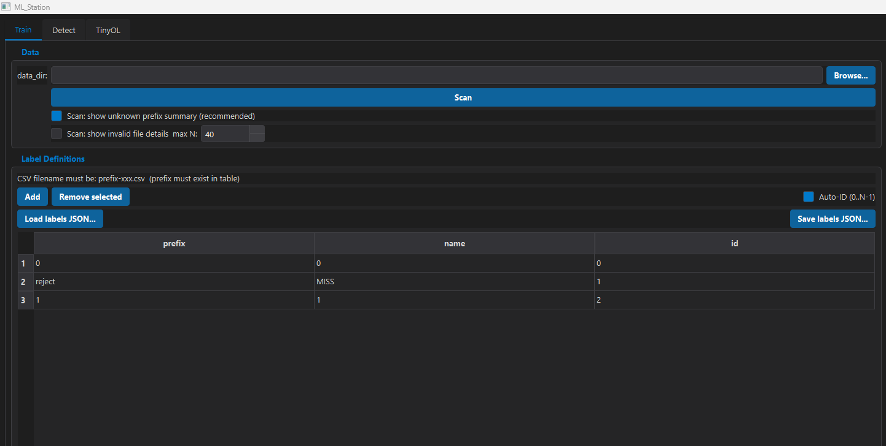
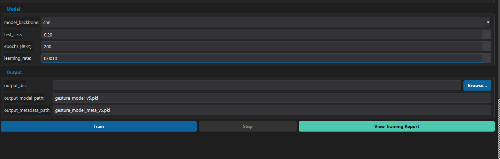
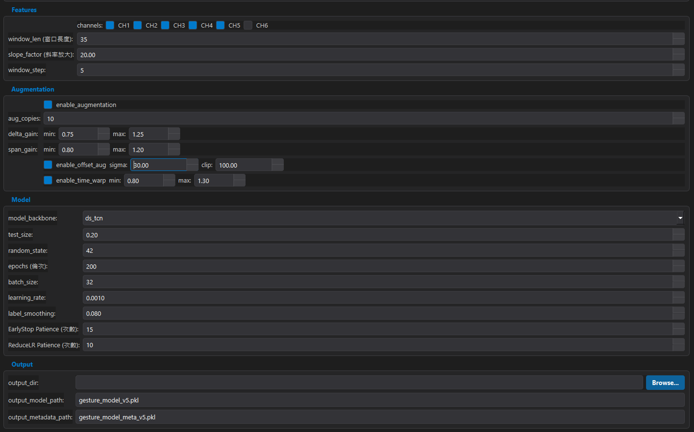

# ML Station 操作說明書

本文件適用於 Disable Viewer 版本，只說明畫面上可以編輯、勾選或點擊的項目。

## 1. Training：Data 與 Label Definitions



### Data

| 畫面項目 | 說明 |
|---|---|
| `data_dir` | Training CSV Dataset 所在資料夾，可直接輸入完整路徑。 |
| `Browse...` | 開啟資料夾選擇視窗。 |
| `Scan` | 掃描 Dataset，確認 CSV 檔名、Label 與資料格式是否可用。選好資料夾後應先執行。 |
| `Scan: show unknown prefix summary` | 顯示未定義 Prefix 摘要，建議勾選。 |
| `Scan: show invalid file details` | 顯示無效 CSV 詳細資料，需要逐檔排查時再勾選。 |
| `max N` | 限制最多顯示幾筆無效檔案資訊，避免 Terminal 內容過多。 |

CSV 檔名必須符合：

```text
prefix-xxx.csv
```

例如 `reject-001.csv` 的 `reject` 必須存在於下方 Label Definitions。

### Label Definitions

| 畫面項目 | 說明 |
|---|---|
| `prefix` | CSV 檔名前方的分類文字，用來判斷檔案屬於哪個 Gesture。 |
| `name` | Gesture 顯示名稱，會寫入 Metadata 並用於結果顯示。 |
| `id` | Model 使用的 Class ID，每個 Label 必須不同。 |
| `Add` | 新增一列 Label。 |
| `Remove selected` | 刪除目前選取的 Label。 |
| `Auto-ID (0..N-1)` | 依表格順序自動將 ID 排成 `0, 1, 2 ...`。 |
| `Load labels JSON...` | 從 JSON 載入 Label Definitions。 |
| `Save labels JSON...` | 將目前表格內容保存成 JSON。 |

設定時請注意：

- `prefix` 必須和 CSV 檔名一致。
- 每個 `id` 不可重複，建議從 `0` 開始連續排列。
- 已部署的 Model 不要任意改變 Class ID 順序，否則顯示名稱可能對錯 Class。

### 建議操作順序

1. 選擇 `data_dir`。
2. 載入 Labels JSON，或手動建立 Label Definitions。
3. 檢查 Prefix、Name 與 ID。
4. 按下 `Scan`。
5. 查看 Terminal 是否出現 Unknown Prefix 或 Invalid File。
6. 掃描正常後，再設定 Model 並開始 Training。

---

## 2. Training：Model 與 Output



### Model

| 畫面項目 | 說明 |
|---|---|
| `model_backbone` | 選擇 Model 類型，目前可選 CNN 或 DS-TCN。 |
| `test_size` | Dataset 中保留作為 Validation 的比例。`0.20` 表示 20%；未指定時使用此預設值。 |
| `epochs` | Training 最大輪數；符合 Early Stop 條件時可能提前結束。 |
| `learning_rate` | 每次更新 Model Weight 的幅度。一般可先使用預設值 `0.0010`。 |

Backbone 建議：

- `cnn`：目前主要使用的時序 CNN，可配合現有 Detection 與 MCU Codegen。
- `ds_tcn`：DS-TCN 架構，專案明確需要時再選擇。

### Output

| 畫面項目 | 說明 |
|---|---|
| `output_dir` | Model、Metadata 與 Report 的輸出資料夾。 |
| `Browse...` | 選擇 Output Directory。 |
| `output_model_path` | Model 輸出檔名。CNN 建議使用 `.keras`；若保留舊 `.pkl` 名稱，請依實際輸出格式確認。 |
| `output_metadata_path` | Metadata 輸出檔名，通常使用 `.pkl`。Detection 時必須與 Model 配對。 |

同一次 Training 的 Model 與 Metadata 建議放在相同資料夾：

```text
training_result/
├─ gesture_model_v5.keras
└─ gesture_model_meta_v5.pkl
```

不要混用不同次 Training 的 Model 與 Metadata。

### 操作按鈕

| 按鈕 | 說明 |
|---|---|
| `Train` | 使用目前設定開始 Training。開始前會檢查 Config 與 Dataset。 |
| `Stop` | 要求停止目前 Training，只有 Training 執行中才可使用。 |
| `View Training Report` | 開啟最近一次成功產生的 Training Report。 |

### 開始 Training 前檢查

- Dataset 已完成 `Scan`。
- 沒有需要處理的 Unknown Prefix。
- Label ID 不重複。
- `test_size` 大於 0 且小於 1。
- `epochs` 與 `learning_rate` 大於 0。
- `output_dir` 可寫入。
- Model 與 Metadata 使用不同檔名。

### Training 期間顯示

Terminal 會顯示每個 Epoch 的結果，例如：

```text
Epoch 7/200 | acc=0.8147, val_acc=0.8292, loss=0.8557, val_loss=0.8282
```

| 數值 | 說明 |
|---|---|
| `acc` | Model 在 Training Data 上的 Accuracy。 |
| `val_acc` | Model 在 Validation Data 上的 Accuracy。 |
| `loss` | Training Data 的 Loss，通常希望逐漸下降。 |
| `val_loss` | Validation Data 的 Loss，用來觀察未參與更新資料的表現。 |

如果 `val_loss` 長時間沒有改善，Training 可能在跑滿 Epoch 前自動結束，屬於正常 Early Stop 行為。

---

## 3. Training 進階設定名詞



### Features

| 畫面項目 | 名詞解釋 | 數值影響 |
|---|---|---|
| `channels` | 選擇要使用的 Sensor Channel。 | 只有勾選的 Channel 會成為 Model Input；Training 與 Detection 必須使用相同 Channel 組合。 |
| `window_len` | 每個 Sample Window 包含的連續資料筆數。 | 越大可觀察較長動作，但需要更多運算與記憶體；`35` 表示每個 Window 使用 35 筆資料。 |
| `slope_factor` | 將相鄰資料差值（Slope／Delta Feature）放大的倍率。 | 越大越強調快速變化；Metadata 會保存此值，Detection 需使用相同設定。 |
| `window_step` | Sliding Window 每次向後移動的資料筆數。 | 越小會產生越多且重疊較高的 Training Samples；`5` 表示每次向後移 5 筆。 |

### Augmentation

`Augmentation` 是從原始 Dataset 產生帶有合理變化的資料，用來增加 Model 對 Sensor 差異與動作速度差異的容忍度。

| 畫面項目 | 名詞解釋 | 數值影響 |
|---|---|---|
| `enable_augmentation` | 是否啟用 Data Augmentation。 | 未勾選時，每個 CSV 只處理一次，下列 Augmentation 設定不生效。 |
| `aug_copies` | 每個 CSV 要產生的資料版本數。 | 數值越大，Training Data 與 Training Time 通常越多；目前每個版本都會重新抽取隨機參數。 |
| `delta_gain min/max` | 對 `ROW - MOVBASE` 的動作差值套用隨機倍率。 | 每個 Channel 會從此範圍隨機取值；`0.75～1.25` 表示模擬動作幅度變成原本的 75%～125%。 |
| `span_gain min/max` | 對 `abs(HOLDAVG - MOVBASE)` 的正規化跨度套用隨機倍率。 | 用來模擬不同裝置或使用者的 Sensor Span 差異。 |
| `enable_offset_aug` | 是否在動作差值加入隨機 Offset。 | 用來模擬基準飄移或 Sensor 偏移。 |
| `sigma` | Offset 的標準差（Standard Deviation）。 | 越大代表允許的隨機偏移通常越大。 |
| `clip` | Offset 的最大絕對值。 | 即使隨機結果超出範圍，也會限制在 `-clip` 到 `+clip` 之間。 |
| `enable_time_warp` | 是否隨機拉長或壓縮時間軸。 | 用來模擬相同 Gesture 以不同速度完成。 |
| `time_warp min/max` | Time Warp Factor 的隨機範圍。 | 小於 `1.0` 會縮短資料序列，大於 `1.0` 會拉長資料序列。 |

### Model

| 畫面項目 | 名詞解釋 | 數值影響 |
|---|---|---|
| `model_backbone` | Training 使用的 Model Architecture。 | `cnn` 使用 CNN；`ds_tcn` 使用 Depthwise-Separable Temporal Convolution Network。 |
| `test_size` | 保留作為 Validation 的檔案比例。 | `0.20` 代表 20%；未指定時使用此預設值。 |
| `random_state` | Dataset Split 使用的 Random Seed。 | 相同 Seed 可重現相同切分；未指定時使用 `42`。 |
| `epochs` | 完整訓練 Dataset 的最大輪數。 | 這是上限；若觸發 Early Stop，會提早結束。 |
| `batch_size` | 每次更新 Model Weight 使用的 Samples 數量。 | 較大通常較快但需要更多 RAM／VRAM；較小更新較頻繁。 |
| `learning_rate` | Optimizer 每次調整 Model Weight 的幅度。 | 太大可能不穩定，太小則收斂較慢；一般先使用預設 `0.001`。 |
| `label_smoothing` | 將 One-hot Label 稍微平滑化，降低 Model 過度自信。 | `0` 表示不平滑；數值過大可能降低分類邊界的明確程度。 |
| `EarlyStop Patience` | `val_loss` 沒有改善時，最多再等待的 Epoch 數。 | 超過次數後停止 Training，並恢復最佳 Model Weight。 |
| `ReduceLR Patience` | `val_loss` 沒有改善時，等待幾個 Epoch 後降低 Learning Rate。 | 觸發時 Learning Rate 會乘以 `0.5`，最低降到 `0.000001`。 |

### Output

| 畫面項目 | 名詞解釋 |
|---|---|
| `output_dir` | Training Artifact 的輸出資料夾。 |
| `output_model_path` | Model 檔名。若填入 `.pkl`，目前 Keras Trainer 會自動改成 `.keras`。 |
| `output_metadata_path` | Metadata 檔名，保存 Channel、Window、Label 與 Feature 等 Detection 所需資訊。 |

---

## 4. 常見問題

### 顯示 `No valid data found.`

請檢查 `data_dir`、CSV 檔名、Label Prefix，以及 CSV 是否包含需要的 Sensor 欄位。

### Training 很早就結束

`epochs` 是最大輪數。Validation 結果沒有繼續改善時，Early Stop 會提前結束。

### Detection 顯示的 Gesture 名稱不正確

請確認 Model 和 Metadata 是同一次 Training 的結果，並確認 Label ID 順序沒有改變。

### 找不到 Training Report

請確認 Training 已正常完成，並查看 Terminal 顯示的 Report Path 或錯誤訊息。

---

## 5. 其他頁面

Detect 與 TinyOL 的可編輯欄位說明，會依後續提供的 UI 圖片補充到本文件。
