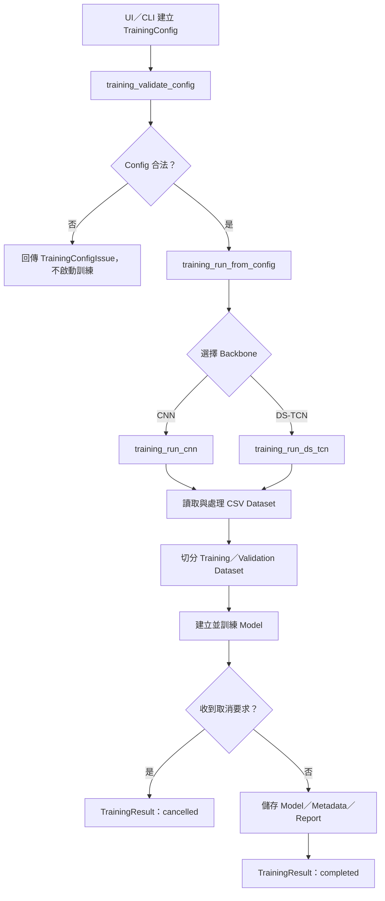
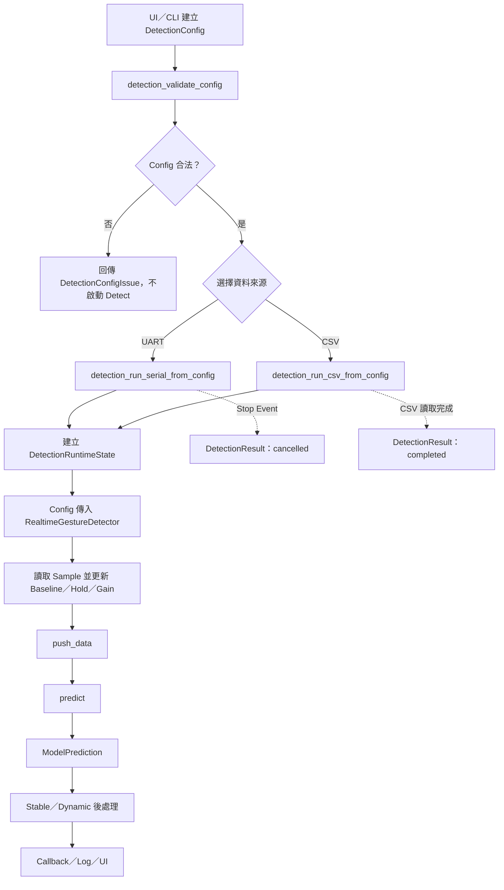

# RESTCN Gesture Tool（Refactor 版本）

本專案是一套可透過 **Qt UI** 或 **Python API** 使用的手勢模型工具，主要功能包含：

- 掃描 CSV Dataset 與驗證 Training Config
- 訓練 CNN／DS-TCN Model
- 使用 UART 即時 Detect
- 使用 CSV Replay Detect
- 產生 MCU CNN Library
- 執行外部 Build／Flash operation

重構後，UI 只負責收集設定與顯示結果；Training、Detection、Codegen、Build 與 Flash 的核心流程都能獨立於 Qt 執行。

## 1. 專案架構

```text
gesture_tool_ui.py
    ├─ training_api.py
    │   ├─ training_validation.py
    │   ├─ training_contracts.py
    │   ├─ training_cnn.py
    │   └─ training_ds_tcn.py
    │
    ├─ detection_api.py
    │   ├─ detection_validation.py
    │   ├─ detection_contracts.py
    │   └─ detection_model.py
    │
    └─ tool_operations.py
        ├─ gen_cnn_lib.py
        ├─ Build process
        └─ Flash process
```

### 主要檔案

| 檔案 | 責任 |
|---|---|
| `gesture_tool_ui.py` | Qt UI 與 Worker adapter，不持有 Training／Detection 核心邏輯。 |
| `training_api.py` | `TrainingConfig` 與共用 Training API。 |
| `training_validation.py` | 純 Training Config 驗證，不依賴 Qt。 |
| `training_contracts.py` | `TrainingProgress`、`TrainingResult` 與取消訊號。 |
| `training_cnn.py` | CNN Dataset 處理、Model 建立與訓練。 |
| `training_ds_tcn.py` | DS-TCN Model 建立與訓練。 |
| `detection_api.py` | UART／CSV Detect API、Runtime State 與後處理流程。 |
| `detection_validation.py` | 純 Detection Config 驗證，不開啟 UART 或載入 Model。 |
| `detection_contracts.py` | `ModelPrediction` 與 `DetectionResult`。 |
| `detection_model.py` | Model／Metadata 載入、Sensor Buffer、Feature 與 `predict()`。 |
| `tool_operations.py` | Codegen、Build、Flash Config、operation 與 child process lifecycle。 |
| `gesture_tool_ui.spec` | PyInstaller 打包設定。 |

完整重構階段、命名對照與驗收條件請參考 [`SMALL_TOOL_REFACTOR_WORK_ITEMS.md`](SMALL_TOOL_REFACTOR_WORK_ITEMS.md)。

## 2. 執行環境

主要 Python dependency：

- PySide6
- TensorFlow
- NumPy
- pandas
- SciPy
- scikit-learn
- joblib
- pyserial
- Matplotlib／Seaborn
- PyInstaller（僅打包時需要）

建議使用獨立 Python environment 安裝相依套件，避免 Training 與 Qt 套件影響系統 Python。

## 3. 啟動 UI

在專案根目錄執行：

```powershell
python gesture_tool_ui.py
```

UI 提供 Training、Detection、TinyOL、Codegen、Build 與 Flash 操作頁面。Worker 只負責把 log、progress、completed、cancelled 與 failed 狀態轉接到 Qt signal。

## 4. Training API

### 4.1 執行流程



### 4.2 非 UI 使用方式

```python
import threading

from training_api import TrainingConfig, training_run_from_config
from training_validation import training_validate_config

config = TrainingConfig(
    data_dir="dataset",
    label_defs=[
        {"id": 0, "prefix": "idle", "name": "Idle"},
        {"id": 1, "prefix": "ok", "name": "OK"},
    ],
    channels=[1, 2, 3, 4, 5],
    window_len=40,
    window_step=2,
    epochs=100,
    batch_size=32,
    output_model_path="output/gesture_model.keras",
    output_metadata_path="output/gesture_model_meta.pkl",
)

issues = training_validate_config(config)
if issues:
    raise ValueError(issues[0].message)

stop_event = threading.Event()
result = training_run_from_config(
    config,
    backbone="cnn",  # 或 "ds_tcn"
    log_fn=print,
    stop_event=stop_event,
    progress_fn=lambda progress: print(progress.to_dict()),
)

print(result.to_dict())
```

### 4.3 Training 標準輸出

`progress_fn` 每個 Epoch 接收一個 `TrainingProgress`：

```text
epoch
total_epochs
loss
accuracy
validation_loss
validation_accuracy
```

Training 完成後回傳 `TrainingResult`：

```text
status                    completed／cancelled
backbone                  cnn／ds_tcn
model_path
metadata_path
report_path
top_1_accuracy
precision
recall
f1_score
validation_accuracy
training_time_seconds
message
```

取消時不回傳 artifact path，避免呼叫端把未完成 Model 誤認為可發布結果。

## 5. Detection API

### 5.1 Config 與 Runtime State

Detection 將固定設定與執行中狀態分開：

| Owner | 內容 |
|---|---|
| `DetectionConfig` | Serial port、baud、Model／Metadata path、Boolean switch、Post-process、Manual Hold 與 Gain 規則。 |
| `DetectionRuntimeState` | 本次執行產生的 baseline、hold、gain map 與 gain ready 狀態。 |
| `_DetectionSession` | row counter、Stable Gesture latch 與 Dynamic Gesture sequence。 |

每次 UART／CSV operation 都會建立新的 `DetectionRuntimeState`，不會沿用前一次裝置的校正資料。

### 5.2 執行流程



### 5.3 DetectionConfig 主要設定

| 分類 | 欄位 |
|---|---|
| UART | `serial_port`、`baud` |
| Model | `model_path`、`metadata_path`、`post_slope_factor` |
| Post-process | `post_alpha`、`post_margin`、`post_exit_thresh`、`post_tier_data`、`infer_stride` |
| Output | `print_proba`、`dynamic_json_path` |
| Hold | `use_manual_holdavg`、`manual_holdavg` |
| Gain | `enable_gain_map`、`std_baseline_a`、`std_holdavg_a`、`min_span_b`、`gain_clamp_min`、`gain_clamp_max` |

### 5.4 非 UI 使用方式

```python
import threading

from detection_api import DetectionConfig, detection_run_csv_from_config
from detection_validation import detection_validate_config

config = DetectionConfig(
    serial_port="COM6",
    baud=921600,
    model_path="output/gesture_model.keras",
    metadata_path="output/gesture_model_meta.pkl",
    post_alpha=0.2,
    post_margin=0.45,
    post_tier_data={},
    post_exit_thresh=0.25,
    post_slope_factor=20.0,
    infer_stride=6,
    print_proba=True,
    use_manual_holdavg=True,
    manual_holdavg={1: 1000, 2: 1000, 3: 1000, 4: 1000, 5: 1000},
    enable_gain_map=False,
    std_baseline_a={},
    std_holdavg_a={},
    min_span_b=300.0,
    gain_clamp_min=0.5,
    gain_clamp_max=2.5,
)

issues = detection_validate_config(config, source="csv")
if issues:
    raise ValueError(issues[0].message)

predictions = []
result = detection_run_csv_from_config(
    config,
    csv_path="sample.csv",
    log_fn=print,
    stop_event=threading.Event(),
    prediction_fn=predictions.append,
)

print(result.to_dict())
```

UART 使用相同的 Config：

```python
from detection_api import detection_run_serial_from_config

result = detection_run_serial_from_config(
    config,
    log_fn=print,
    stop_event=stop_event,
    prediction_fn=predictions.append,
)
```

> `detection_run_*` 不會自動呼叫 `detection_validate_config()`。UI 已經會先驗證；CLI／其他應用必須在啟動 Detect 前主動驗證。

### 5.5 Detection 標準輸出

`prediction_fn` 只接收 Model 原始輸出 `ModelPrediction`：

```text
pred_id          Model 判斷的 Class ID
confidence       最高預測機率
probabilities    每個 Class 的完整機率
```

Stable label、Dynamic Gesture 與 UI 顯示是 Detection API 的後處理結果，不混入 Model 原始輸出。

Operation 結束後回傳 `DetectionResult`：

```text
status     completed／cancelled／failed
source     serial／csv
message
payload
```

UART 的 serial handle 無論正常取消或發生例外，都會在 operation 結束前關閉。

## 6. Gencode／Build／Flash

`tool_operations.py` 集中提供不依賴 Qt 的 Config 與 operation boundary：

```text
CodegenConfig
BuildConfig
FlashConfig
codegen_run_from_config()
build_run_from_config()
flash_run_from_config()
```

外部 process 的輸出透過 `log_fn` 傳回；取消時會先執行 terminate，逾時後才使用 kill，並確保 stdout 與 process handle 被回收。

## 7. Model 與 Metadata 條件

Detection Model 必須符合以下條件：

- Model 輸出為 `softmax(num_classes)`。
- Metadata 的 `channels` 與實際輸入 channel 一致。
- Metadata 包含非空的 `feature_cols`。
- Metadata 提供 `id_to_name`、`windowing` 與 Training 使用的 feature flags。
- CNN Model path 使用 `.keras` 或 `.h5`。
- CNN Training 與 Detection 的 waveform、variance、mean input shape 必須一致。

如果 Metadata 宣告 CNN，但 Config 選到同名 `.pkl`，Detection API 會嘗試尋找對應的 `.keras` Model；找不到時會透過 `log_fn` 輸出警告。

## 8. 驗證方式

### Python 語法

```powershell
python -m py_compile training_api.py training_contracts.py training_validation.py training_cnn.py training_ds_tcn.py detection_api.py detection_contracts.py detection_validation.py detection_model.py tool_operations.py gesture_tool_ui.py
```

### 建議驗收順序

1. 使用 `training_validate_config()` 驗證合法與非法 Training Config。
2. 使用少量 Dataset 分別執行 CNN 與 DS-TCN Training。
3. 確認 `TrainingProgress` 與 `TrainingResult` 欄位。
4. 使用 CSV Replay 驗證 `ModelPrediction`、Stable 與 Dynamic output。
5. 使用實體 COM port 驗證 UART Detect 與 Stop Event。
6. 重複啟動 Detect，確認 Gain／Baseline／Hold 不會沿用前一次 Runtime State。
7. 驗證 Codegen artifact，再執行 MCU Build／Flash。

目前已完成假的 UART／Detector 與臨時 CSV 流程驗證；真實 Sensor 與實際 TensorFlow Model 仍應在目標環境進行最後驗收。

## 9. PyInstaller 打包

```powershell
python -m PyInstaller --noconfirm gesture_tool_ui.spec
```

輸出程式：

```text
dist/ML_Station.exe
```

`gesture_tool_ui.spec` 已包含 Training、Detection、Codegen 與主要 ML dependency。

## 10. 舊版名稱對照

| 舊名稱 | Refactor 名稱 |
|---|---|
| `ui_v6.py` | `gesture_tool_ui.py` |
| `ui_v6.spec` | `gesture_tool_ui.spec` |
| `train_gesture_cnn_v1.py` | `training_cnn.py` |
| `train_gesture_ds_tcn_v1.py` | `training_ds_tcn.py` |
| `detect_gesture_universal_manual_holdavg_v5.py` | `detection_model.py` |

新程式應使用 Refactor 名稱；舊檔案不再作為主要入口。
