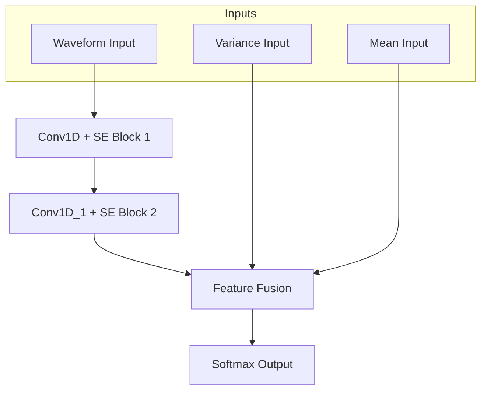
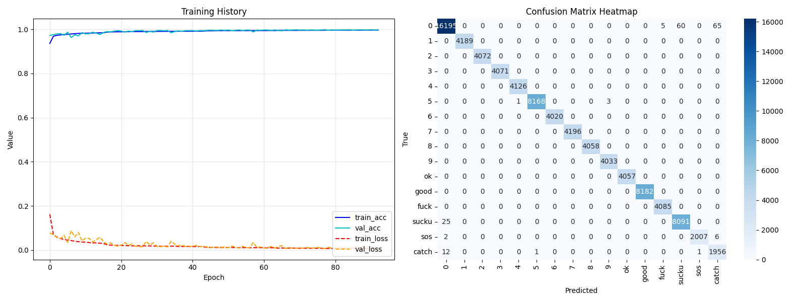

# Respiratory Gesture Classification Platform (CNN Station Breathe)

這是一個專為呼吸動作辨識設計的整合開發平台。涵蓋了從數據採集、神經網絡訓練、即時參數調校到自動化產生 MCU C 代碼的完整流程。

---

## 1. 系統架構與設計理念

### 1.1 特徵提取 (Feature Extraction)
系統採集多重特徵輸入：
*   **Input Waveform**: 包含每個通道的 **Level (位準)** 與 **Slope (斜率)**。
*   **Input Variance & Mean**: 用於捕捉穩定度與 Baseline 統計特徵。

### 1.2 深度神經網路架構 (Neural Network Architecture)
本系統採用 **Dual-SE 2-Layer CNN**，專為嵌入式環境優化，確保高辨識率與低運算延遲。

#### 資料流向圖 (Data Flow)

---

## 2. 訓練流程 (Train Tab)

### 2.1 資料標籤與數據增強

*   **Label Definitions**: 定義 CSV 名稱前綴與 ID。

*   **Features**: 設定 `window_len` 與 `slope_factor`。
*   **Augmentation**: 包含 `delta_gain`、`time_warp` 等數據增強手段。

### 2.2 模型訓練與報告

*   訓練完成後可導出 `.keras` 以及 `.pkl` 檔案。

*   **Training Report**: 訓練完成後點擊 View 即可查看 Loss/Accuracy 曲線。

---

## 3. 即時偵測與調校 (Detect Tab)

此頁面用於透過 Serial 連接 MCU 並即時測試模型效果。

### 3.1 關鍵調校參數

*   **Smoothing Alpha**: 平滑係數，平衡延遲與穩定度。
*   **Switching Margin**: 切換門檻，防止手勢跳動。

### 3.2 進階校準 (HOLDAVG & Gain Map)

*   **Manual HOLDAVG**: 若系統缺少即時 Baseline，可手動指定各通道基準。
*   **Gain Map**: 用於校準不同感測端之間的增益係數。

---

## 4. 代碼自動產生 (Gen Code Tab)

此頁面用於產生 MCU 使用的 `cnn_lib`。

### 4.1 模型導入與輸出設定

*   **Meta/Model**: 指定訓練好的 `.pkl` 與 `.keras` 檔案。
*   **Output Dir**: 指定 `cnn_lib` 產出的資料夾路徑。

### 4.2 後處理與階層驗證 (Tiers)

*   **GENERATE ALL**: 點擊此按鈕將所有參數與權重寫入 C 標頭檔。
*   **Tier Definitions**: 在此設定全域的 Fast/Normal/Strict 驗證幀數。

---

## 5. 自動化部署 (Auto Build Tab)

*   **功能描述**: 整合 FSP 工具，實現一鍵編譯與燒錄。
*   **目前狀態**: 🔒 **現階段功能保留**，待後續專案正式落地確定後開放。

---

## 6. 修改歷史 (Change Log)

#### [v1.1.0] - 2026-04-10
**核心功能優化與韌體連動同步**
*   **[新增] Slope Factor 參數化**：支持斜率放大，解決微弱呼吸趨勢難以捕捉的問題。
*   **[優化] Tiered Validation**：實現三段式（Fast/Normal/Strict）驗證邏輯，平衡響應速度與穩定性。
*   **[修正] 內存管理**：根據 `CNN_WIN_LEN` 自動調整 Workspace 大小，防止 MCU 溢出。

#### [v1.0.5] - 2026-04-09
**介面功能增強**
*   **[新增] 數據增強模組**：加入時間扭曲與增益擴展，提升模型通用性。
*   **[修正] CSV 格式**：連動更新 Log 檔案中的統計欄位。

#### [v1.0.0] - 2026-04-07
**架構重大革新 (3-Layer -> Dual-SE 2-Layer)**
*   **[架構調整]**：將原本的 3 層 CNN 精簡為 **2 層**，顯著降低運算功耗與內存佔用，更適配 RA6M5。
*   **[優化] 加入 SE Block**：引入通道注意力機制，讓模型能自動學習並聚焦於訊號最強的感測路徑。
*   **[優化] 雙流特徵融合**：結合波形與變異數分析，精確區分真正的呼吸與感測器漂移。

---

## 7. MCU 整合指南
產生的代碼會自動同步所有 UI 定義的參數。引導入口位於 `sil_app_glove_ml.c`。

---

## 💡 調校建議 (FAQ)
*   **Q: 呼氣 (Exhalation) 很難被辨識？**
    *   A: 調大 `Slope Factor` 並將該手勢 Tier 設為 `Fast`。
*   **Q: 手勢辨識後一直卡著變不回來？**
    *   A: 調大 `Switching Margin` 並調高 `Latch Exit Thresh`。
