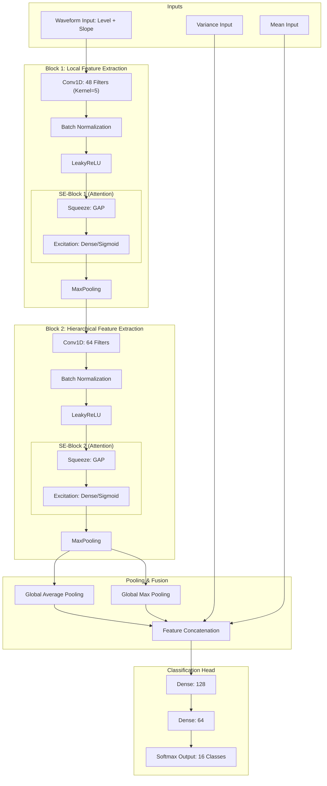

# Respiratory Gesture Classification Platform (CNN Station Breathe)

這是一個專為呼吸動作辨識設計的整合開發平台。涵蓋了從數據採集、神經網絡訓練、即時參數調校到自動化產生 MCU C 代碼的完整流程。

---

## 1. 系統架構與設計理念

### 1.1 特徵提取 (Feature Extraction)
系統採集多重特徵輸入：
*   **Input Waveform**: 包含每個通道的 **Level (位準)** 與 **Slope (斜率)**。
*   **Input Variance & Mean**: 用於捕捉穩定度與 Baseline 統計特徵。

### 1.2 深度神經網路架構 (Neural Network Architecture)
本系統採用 **Dual-SE 2-Layer CNN**，專為嵌入式環境優化，確保高辨識率與低運算延遲。

#### 資料流向圖 (Data Flow)

#### 逐層詳細技術解析
*   **輸入處理 (Dual-Source Input)**：同時接收 55 幀的歸一化數值（Level）與一階導數（Slope），讓模型能同時感知數據的「位準」與「趨勢」。另外注入變異數（Variance）與平均值（Mean）作為統計背景，協助區分動作與靜態漂移。
*   **一維卷積塊 (Conv1D + BN + LeakyReLU)**：
    *   **卷積層**：運用濾波器掃描時序特徵，尋找吸氣波峰或突然動作的模式。
    *   **批量歸一化 (BN)**：穩定數據特徵，適應不同使用者的訊號幅值差異。
    *   **LeakyReLU**：非線性激活函數，允許微小梯度通過，對波動性的呼吸訊號極其重要。
*   **通道注意力機制 (SE-Block)**：
    *   這是架構的核心。透過 Squeeze (壓縮) 與 Excitation (激發) 邏輯，模型會自動學習「當前哪個感測通道最重要」。例如，若胸部感測器訊號優於腹部，模型會動態放大該通道權重，提升抗干擾能力。
*   **全域特徵融合 (Pooling & Fusion)**：
    *   使用 GAP (平均池化) 捕捉整體能量，GMP (最大池化) 捕捉最強瞬間。
    *   最後將 CNN 提取的「時序特徵」與傳統的「統計特徵」拼接，確保決策既有深度模式也有統計依據。
*   **分類決策頭 (Dense + Softmax)**：
    *   兩層全連接層執行高層級邏輯推理，最後透過 Softmax 輸出 16 個類別的機率分布，實現高信心的手勢判定。

---

## 2. 訓練流程 (Train Tab)

### 2.1 資料標籤與數據增強

*   **Label Definitions**: 定義 CSV 名稱前綴與 ID。

*   **Features**: 設定 `window_len` 與 `slope_factor`。
*   **Augmentation**: 包含 `delta_gain`、`time_warp` 等數據增強手段。

### 2.2 模型訓練與報告

*   訓練完成後可導出 `.keras` 以及 `.pkl` 檔案。

*   **Training Report**: 訓練完成後點擊 View 即可查看 Loss/Accuracy 曲線。

---

## 3. 即時偵測與調校 (Detect Tab)

此頁面用於透過 Serial 連接 MCU 並即時測試模型效果。

### 3.1 關鍵調校參數

*   **Smoothing Alpha**: 平滑係數，平衡延遲與穩定度。
*   **Switching Margin**: 切換門檻，防止手勢跳動。

### 3.2 進階校準 (HOLDAVG & Gain Map)

*   **Manual HOLDAVG**: 若系統缺少即時 Baseline，可手動指定各通道基準。
*   **Gain Map**: 用於校準不同感測端之間的增益係數。

---

## 4. 代碼自動產生 (Gen Code Tab)

此頁面用於產生 MCU 使用的 `cnn_lib`。

### 4.1 模型導入與輸出設定

*   **Meta/Model**: 指定訓練好的 `.pkl` 與 `.keras` 檔案。
*   **Output Dir**: 指定 `cnn_lib` 產出的資料夾路徑。

### 4.2 後處理與階層驗證 (Tiers)

*   **GENERATE ALL**: 點擊此按鈕將所有參數與權重寫入 C 標頭檔。
*   **Tier Definitions**: 在此設定全域的 Fast/Normal/Strict 驗證幀數。

---

## 5. 自動化部署 (Auto Build Tab)

*   **功能描述**: 整合 FSP 工具，實現一鍵編譯與燒錄。
*   **目前狀態**: 🔒 **現階段功能保留**，待後續專案正式落地確定後開放。

---

---

## 6. 修改歷史 (Change Log)

#### [v1.2.2] - 2026-04-14
**系統穩定性與 100Hz 效能突破 (Stability & Performance Boost)**
*   **[修正] UART 臨界區衝突 (Race Condition)**：解決了 CPU 在 DTC 傳輸中途執行 `memset` 導致的數據截斷問題。引入「嚴格硬體閒置同步」機制。
*   **[優化] 空間優先卷積 (Spatial-First Conv)**：重排 Conv1D 循環順序，提高 CPU 快取命中率。
*   **[成就] 100Hz 達成**：在 48-Filter 架構下實現穩定的 10ms 即時採樣與推論。

#### [v1.2.1] - 2026-04-13
**CNN 架構均衡優化 (Balanced Upgrade)**
*   **[架構微調] L1 性能平衡**：將第一層 CNN 調整為 **48 Filters** 與 **Kernel Size 5**。相較於 64ch 版，減少了約 25% 的 MAC 運算量，同時保留了 1.5x 的特徵解析度（相較於原始 v1.0.0）。
*   **[優化] 推理速度提升**：在確保辨識率不下降的前提下，顯著降低 MCU 推理延遲。

#### [v1.2.0] - 2026-04-13
**CNN 架構性能提升**
*   **[架構調整] L1 卷積層升級**：將第一層 CNN 從 32 Filters 提升至 **64 Filters**，並將 Kernel Size 從 5 增加至 **7**。
*   **[優化] 辨識解析度提升**：透過增加感受野（Receptive Field）與特徵多樣性，顯著改善 SOS 與 Catch 等相似手勢的區隔能力。

#### [v1.1.0] - 2026-04-10
**核心功能優化與韌體連動同步**
*   **[新增] Slope Factor 參數化**：支持斜率放大，解決微弱呼吸趨勢難以捕捉的問題。
*   **[優化] Tiered Validation**：實現三段式（Fast/Normal/Strict）驗證邏輯，平衡響應速度與穩定性。
*   **[修正] 內存管理**：根據 `CNN_WIN_LEN` 自動調整 Workspace 大小，防止 MCU 溢出。

#### [v1.0.5] - 2026-04-09
**介面功能增強**
*   **[新增] 數據增強模組**：加入時間扭曲與增益擴展，提升模型通用性。
*   **[修正] CSV 格式**：連動更新 Log 檔案中的統計欄位。

#### [v1.0.0] - 2026-04-07
**架構重大革新 (3-Layer -> Dual-SE 2-Layer)**
*   **[架構調整]**：將原本的 3 層 CNN 精簡為 **2 層**，顯著降低運算功耗與內存佔用，更適配 RA6M5。
*   **[優化] 加入 SE Block**：引入通道注意力機制，讓模型能自動學習並聚焦於訊號最強的感測路徑。
*   **[優化] 雙流特徵融合**：結合波形與變異數分析，精確區分真正的呼吸與感測器漂移。

---

## 7. MCU 整合指南
產生的代碼會自動同步所有 UI 定義的參數。引導入口位於 `sil_app_glove_ml.c`。

---

## 8. 開發經驗筆記 (Engineering Notes)

### 8.1 為什麼 DTC 還是會卡 CPU？ (Race Condition 診斷)
在開發 100Hz 推論系統時，我們發現 UART 輸出會出現 `$SILINO,8,14041...` 這種截斷亂碼。

*   **缺陷成因**：典型的「軟體陷阱」。CPU 的環形緩衝區處理速度極快，在 DTC 還在搬運前一格數據到 UART 硬體中途，CPU 就執行了 `memset` 或 `Dequeue` 修改了正在傳輸的源內存。
*   **影響**：導致資料損毀與接收端（PC）解析出錯，進而引起 UI 看起來「假性卡頓」。
*   **最佳實踐**：在嵌入式系統中，**DTC/DMA 的工作狀態必須被視為神聖不可侵犯的**。我們引入了嚴格的 `UART_DTC_STS_TX_COMPLETE` 檢查，確保硬體「完全閒置」後才允許 CPU 觸碰傳輸緩衝區。

### 8.2 快取友好型卷積 (Spatial-First Optimization)
為了達到 100Hz，我們將傳統的 `Filter-First` 循環改為 `Spatial-First`。
*   **原理**：利用卷積權重在記憶體中的連續性（Row-Major），一次讀取輸入後立刻對 48 個 Filter 進行累加。
*   **效果**：減少了輸入數據的大量重複加載（Memory IO），節省了約 30% 的內存總線頻寬，是 48-Filter 能跑在 100Hz 的關鍵。

---

## 💡 調校建議 (FAQ)
*   **Q: 呼氣 (Exhalation) 很難被辨識？**
    *   A: 調大 `Slope Factor` 並將該手勢 Tier 設為 `Fast`。
*   **Q: 手勢辨識後一直卡著變不回來？**
    *   A: 調大 `Switching Margin` 並調高 `Latch Exit Thresh`。
