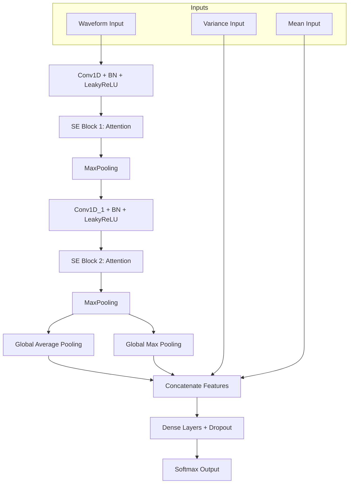

# Respiratory Gesture Classification Platform (CNN Station Breathe)

這是一個專為呼吸動作（如：吸氣、呼氣、屏息、談話等）辨識設計的整合開發平台。本平台涵蓋了從數據採集、神經網絡訓練、即時參數調校到自動化產生 MCU C 代碼的完整流程。

---

## 1. 系統架構與設計理念

### 1.1 特徵提取 (Feature Extraction)
系統採集 N 個通路的感測器數據，並將每一幀數據轉化為多重特徵輸入：
*   **Input Waveform (時序特徵)**：包含了每個通道的 **Level (數值位準)** 與 **Slope (斜率/動態)**。
*   **Input Variance (統計特徵)**：捕捉時窗內的信號變異度，用於區分穩定狀態與劇烈動作。
*   **Input Mean (統計特徵)**：時窗內的平均位準，作為 Baseline 的輔助參考。

### 1.2 深度神經網路架構 (Neural Network Architecture)

本系統採用針對嵌入式優化的 **Dual-SE 2-Layer CNN**。其特色在於使用 SE (Squeeze-and-Excitation) 模塊來動態調整通道權重，並結合了多路特徵融合技術。

#### 數據流向圖 (Data Flow)


#### 詳細層級表 (Layer Summary)
本架構在提供強大擬合能力的同時，將參數總量控制在 **45,288 (約 176 KB)**，完美適配 MCU 的 Flash/RAM 限制。

| Layer (type) | Output Shape | Param # | Connected to |
| :--- | :--- | :--- | :--- |
| **input_waveform (Input)** | (None, 55, 10) | 0 | - |
| **conv1d (Conv1D)** | (None, 55, 32) | 1,632 | Waveform |
| **SE Block 1** | (None, 55, 32) | 552 | conv1d |
| **max_pooling1d** | (None, 27, 32) | 0 | - |
| **conv1d_1 (Conv1D)** | (None, 27, 64) | 6,208 | SE Block 1 |
| **SE Block 2** | (None, 27, 64) | 2,128 | conv1d_1 |
| **max_pooling1d_1** | (None, 13, 64) | 0 | - |
| **global_pool (GAP/GMP)** | (None, 128) | 0 | Concatenated |
| **input_variance (Input)** | (None, 5) | 0 | - |
| **input_mean (Input)** | (None, 5) | 0 | - |
| **Feature Fusion (Merge)** | (None, 192) | 384 | Pool + Stat Inputs |
| **dense_6 (Dense)** | (None, 128) | 24,704 | Fusion |
| **dense_7 (Dense)** | (None, 64) | 8,256 | dense_6 |
| **dense_8 (Output)** | (None, 16) | 1,040 | dense_7 |

**Total params: 45,288 (176.91 KB)**

---

## 2. 訓練流程 (Train Tab)

此頁面用於配置特徵提取參數、數據增強以及模型訓練超參數。

### 2.1 資料掃描與標籤定義

*   **Data Source**: 指定 CSV 資料夾並進行自動掃描。
*   **Label Definitions**: 定義 CSV 檔案名稱前綴與對應的手勢 ID。

### 2.2 特徵與數據增強

*   **Features**: 選擇參與訓練的通道，設定 `window_len` 與關鍵的 `slope_factor`。
*   **Augmentation**: 提供 `delta_gain`、`time_warp` 等多種增強手段，確保模型能適應不同的環境細微變化。

### 2.3 模型訓練與導出

*   設定訓練輪次 (Epochs)、學習率 (Learning Rate) 等超參數。
*   訓練完成後可直接點擊 **View Training Report** 查看模型成效。

### 2.4 訓練報告範例

*   包含 Loss/Accuracy 曲線，幫助分析模型是否過擬合 (Overfitting)。

---

## 3. 即時偵測與調校 (Detect Tab)


此頁面用於透過 Serial 連接 MCU 並即時測試模型效果。**這裡設定的參數可以直接在 UI 測試，滿意後再寫入 MCU。**

*   **Smoothing Alpha**: EWMA 平滑係數，平衡延遲感與穩定度。
*   **Slope Factor**: 同訓練設定，用於放大呼吸信號的動態趨勢。
*   **Tier Definitions**: 全域預設的驗證等級（Fast/Normal/Strict），根據不同手勢需求選擇。

---

## 4. 代碼自動產生 (Gencode Tab)

當測試滿意後，使用此頁面產生工業級的 C 函式庫 (`cnn_lib`)。

### 4.1 核心參數寫入

*   確保韌體端的 `CNN_SLOPE_FACTOR` 與 `CNN_INFER_STRIDE` 與 UI 設定一致。

### 4.2 手勢 Tier 詳細表

*   針對每個特定手勢分配對應的驗證層級（例如：呼吸動作設為 Fast，靜止動作設為 Strict）。

---

## 5. 自動化部署 (Auto Build Tab)


*   此模組整合了 FSP (Flexible Software Package) 的命令行工具，實現一鍵自動編譯並下載韌體至 RA6M5 開發板。

---

## 6. MCU 整合指南

產生的 `cnn_lib` 放置於韌體目錄後，主要連動點位於 `sil_app_glove_ml.c`:

```c
// 1. 初始化
cnn_feat_init(&ctx, CNN_WIN_LEN, CNN_INFER_STRIDE, CNN_SLOPE_FACTOR);
cnn_detect_init();
cnn_post_init(&post_ctx);

// 2. 特徵計算與推理
if (cnn_compute_features(&ctx, row_u16, base_u16, holdavg_u16, ...)) {
    cnn_detect_predict(waveform, features, probas);
    int final_id = cnn_post_update(&post_ctx, probas);
}
```

---

## 💡 調校建議 (FAQ)

*   **Q: 呼氣 (Exhalation) 很難被辨識？**
    *   A: 調大 `Slope Factor` (例如 30~50)，並將該手勢的 Tier 設為 `Fast`。
*   **Q: 手勢辨識後一直卡著變不回來？**
    *   A: 調大 `Switching Margin` (例如 0.45) 並調高 `Latch Exit Thresh` (例如 0.30)。
*   **Q: MCU 頻率掉到 30Hz 以下？**
    *   A: 檢查 `Inference Stride`。設置為 6 到 10 之間能有效分配 CPU 資源。
