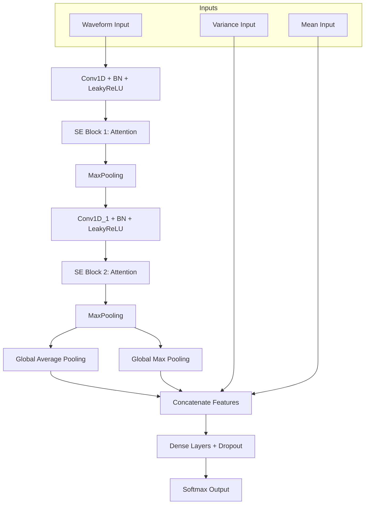

# Respiratory Gesture Classification Platform (CNN Station Breathe)

這是一個專為呼吸動作（如：吸氣、呼氣、屏息、談話等）辨識設計的整合開發平台。本平台涵蓋了從數據採集、神經網絡訓練、即時參數調校到自動化產生 MCU C 代碼的完整流程。

---

## 1. 系統架構與設計理念

### 1.1 特徵提取 (Feature Extraction)
系統採集 N 個通路的感測器數據，並將每一幀數據轉化為多重特徵輸入：
*   **Input Waveform (時序特徵)**：包含了每個通道的 **Level (數值位準)** 與 **Slope (斜率/動態)**。
*   **Input Variance (統計特徵)**：捕捉時窗內的信號變異度，用於區分穩定狀態與劇烈動作。
*   **Input Mean (統計特徵)**：時窗內的平均位準，作為 Baseline 的輔助參考。

### 1.2 深度神經網路架構 (Neural Network Architecture)

本系統採用針對嵌入式優化的 **Dual-SE 2-Layer CNN**。其特色在於使用 SE (Squeeze-and-Excitation) 模塊來動態調整通道權重，並結合了多路特徵融合技術。

#### 數據流向圖 (Data Flow)


#### 詳細層級表 (Layer Summary)
本架構在提供強大擬合能力的同時，將參數總量控制在 **45,288 (約 176 KB)**，完美適配 MCU 的 Flash/RAM 限制。

| Layer (type) | Output Shape | Param # | Connected to |
| :--- | :--- | :--- | :--- |
| **input_waveform (Input)** | (None, 55, 10) | 0 | - |
| **conv1d (Conv1D)** | (None, 55, 32) | 1,632 | Waveform |
| **SE Block 1** | (None, 55, 32) | 552 | conv1d |
| **max_pooling1d** | (None, 27, 32) | 0 | - |
| **conv1d_1 (Conv1D)** | (None, 27, 64) | 6,208 | SE Block 1 |
| **SE Block 2** | (None, 27, 64) | 2,128 | conv1d_1 |
| **max_pooling1d_1** | (None, 13, 64) | 0 | - |
| **global_pool (GAP/GMP)** | (None, 128) | 0 | Concatenated |
| **input_variance (Input)** | (None, 5) | 0 | - |
| **input_mean (Input)** | (None, 5) | 0 | - |
| **Feature Fusion (Merge)** | (None, 192) | 384 | Pool + Stat Inputs |
| **dense_6 (Dense)** | (None, 128) | 24,704 | Fusion |
| **dense_7 (Dense)** | (None, 64) | 8,256 | dense_6 |
| **dense_8 (Output)** | (None, 16) | 1,040 | dense_7 |

**Total params: 45,288 (176.91 KB)**

---

## 2. 訓練流程 (Train Tab)

此頁面用於配置特徵提取參數、數據增強以及模型訓練超參數。


### 2.1 關鍵配置區塊
*   **Features (特徵)**:
    *   `channels`: 選擇要參與訓練的感測器通道。
    *   `window_len`: 歷史參考幀數。
    *   `slope_factor`: 斜率放大倍率。
*   **Augmentation (數據增強)**:
    *   包含 `delta_gain`、`span_gain`、`time_warp` 等功能，用於提升模型在不同感測器誤差下的魯棒性。
*   **Model (CNN)**:
    *   設置 `Epochs` (訓練輪次)、`Batch Size`、`Learning Rate` 等超參數。

---

## 3. 即時偵測與調校 (Detect Tab)

此頁面用於透過 Serial 連接 MCU 並即時測試模型效果。**這裡設定的參數可以直接在 UI 測試，滿意後再寫入 MCU。**

*   **Smoothing Alpha (0.01 ~ 1.0)**:
    *   低值 (0.1 ~ 0.3): 極度平滑，穩定度高，但反應慢（有延遲感）。
    *   高值 (0.5 ~ 0.8): 響應極快，但原始數據抖動時 UI 可能會閃爍。
*   **Switching Margin (0.0 ~ 1.0)**:
    *   切換門檻。當「新手勢的信心度」必須贏過「舊手勢」這麼多時，才會發生切換。防止在兩個信號接近時頻繁跳動。
*   **Latch Exit Thresh**:
    *   退出門檻。當前手勢的信心度低於此值時，系統會強制回歸到靜態 (如：convert) 狀態。
*   **Inference Stride**:
    *   跳幀頻率。例如設置為 6，表示每 6 次採樣執行一次 CNN 推理。這能大幅降低 MCU CPU 負擔，並維持 100Hz 的數據傳輸頻率。

---

## 4. 代碼自動產生 (Gencode Tab)

當測試滿意後，使用此頁面產生工業級的 C 函式庫 (`cnn_lib`)。

### 4.1 關鍵參數定義
*   **Slope Factor (斜率放大係數)**: 
    *   設定在 `cnn_features_lib.h` 中的 `CNN_SLOPE_FACTOR`。
    *   數值越高，對於緩慢變化的呼吸信號（如呼氣）越靈敏。
*   **Tier Definitions (階層式驗證)**:
    *   **Fast (快速層級)**: 追求最短延遲 (Stable Count = 0)。
    *   **Normal (標準層級)**: 平衡穩定與速度，適合大多數手勢。
    *   **Strict (嚴格層級)**: 針對容易誤判的複雜動作，強制要求更多的連續穩定幀數。

### 4.2 產生的檔案清單
1.  `cnn_detect.c/h`: CNN 推理引擎核心。
2.  `cnn_features_lib.c/h`: 特徵提取與斜率放大邏輯。
3.  `cnn_postprocess.c/h`: 包含 Alpha 平滑與 Tier 驗證的後處理邏輯。
4.  `cnn_weights.h`: 自動將 Keras 模型轉換後的靜態權重。
5.  `cnn_model_data.c/h`: 儲存感測器 Baseline 與 Holdavg 設定。

---

## 5. MCU 整合指南

產生的 `cnn_lib` 放置於韌體目錄後，主要連動點位於 `sil_app_glove_ml.c`:

1.  **初始化**:
    ```c
    cnn_feat_init(&ctx, CNN_WIN_LEN, CNN_INFER_STRIDE, CNN_SLOPE_FACTOR);
    cnn_detect_init();
    cnn_post_init(&post_ctx);
    ```
2.  **主迴圈處理**:
    1.  讀取感測器 Raw 數據。
    2.  呼叫 `cnn_compute_features` 以 Level+Slope 格式填充。
    3.  若返回 `true`（達成 Stride 條件），呼叫 `cnn_detect_predict` 獲取原始機率。
    4.  呼叫 `cnn_post_update` 進行平滑與階層檢查，最終獲取穩定手勢 ID。

---

## 💡 調校建議 (FAQ)

*   **Q: 呼氣 (Exhalation) 很難被辨識？**
    *   A: 調大 `Slope Factor` (例如 30~50)，並將該手勢的 Tier 設為 `Fast`。
*   **Q: 手勢辨識後一直卡著變不回來？**
    *   A: 調大 `Switching Margin` (例如 0.45) 並調高 `Latch Exit Thresh` (例如 0.30)。
*   **Q: MCU 頻率掉到 30Hz 以下？**
    *   A: 檢查 `Inference Stride`。設置為 6 到 10 之間能有效分配 CPU 資源，恢復到 100Hz 輸出。
